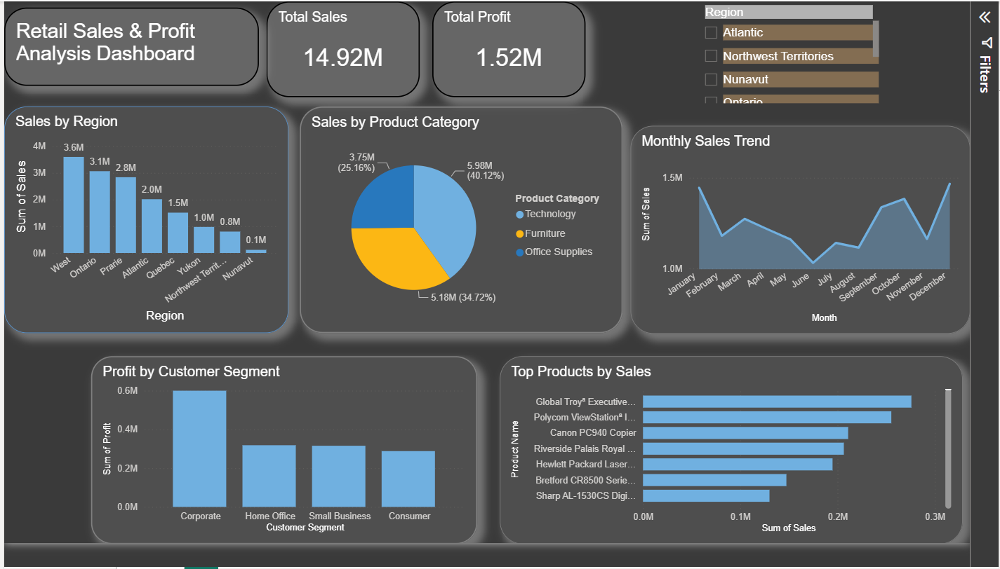

# 📊 Retail Sales & Profit Dashboard

## 📌 Project Overview

This project is an interactive **Retail Sales & Profit Dashboard** developed using **Microsoft Power BI**. The dashboard helps analyze sales performance, profitability, product categories, regions, and monthly sales trends through interactive visualizations and KPIs.

The main goal of this project is to transform raw retail sales data into meaningful business insights that can support data-driven decision-making.

---

## 🎯 Objectives

* Analyze overall sales and profit performance
* Identify the best-performing regions and product categories
* Find top-performing products
* Analyze monthly sales trends
* Understand the impact of discounts on profitability
* Create an interactive and user-friendly business dashboard

---

## 🛠️ Tools & Technologies

* **Power BI**
* **Power Query**
* **DAX**
* **Microsoft Excel**
* Data Visualization
* Data Cleaning & Transformation

---

## 🧹 Data Preparation

The dataset was prepared before creating the dashboard.

Key data preparation steps included:

* Removing duplicate records
* Handling missing values
* Formatting date fields
* Checking data types
* Cleaning and transforming columns
* Creating calculated measures using DAX

---

## 📈 Key Performance Indicators (KPIs)

The dashboard includes the following important KPIs:

* 💰 **Total Sales**
* 📈 **Total Profit**
* 📦 **Total Quantity**
* 🏷️ **Average Discount**

These KPIs provide a quick overview of the overall business performance.

---

## 📊 Dashboard Visualizations

The dashboard contains visualizations such as:

### 🌎 Sales by Region

Shows how sales are distributed across different regions.

### 🛍️ Sales by Product Category

Compares sales performance across different product categories.

### 🏆 Top 10 Products

Identifies the products generating the highest sales.

### 📅 Monthly Sales Trend

Shows how sales change over time and helps identify monthly trends and patterns.

### 📊 Profit & Sales Analysis

Provides an overview of revenue and profitability to understand business performance.

---

## 🔍 Key Insights

The dashboard can be used to identify:

* High-performing regions
* Best-selling product categories
* Top-performing products
* Monthly sales patterns
* Differences between sales and profit
* The relationship between discounts and profitability


## 🖥️ Dashboard Preview

Add your Power BI dashboard screenshot here:



```


## 🎥 Project Demo

A demo video of the dashboard is included in this repository to demonstrate the dashboard's interactive features and visualizations.

---

## 📂 Project Files

```text
Retail-Sales-Profit-Dashboard/
│
├── Retail Sales & Profit dashboard.pbix
├── Dashboard.png
├── demo.mp4
└── README.md
```

### File Description

| File                                   | Description                   |
| -------------------------------------- | ----------------------------- |
| `Retail Sales & Profit dashboard.pbix` | Power BI dashboard file       |
| `Dashboard.png`                        | Dashboard preview image       |
| `demo.mp4`                             | Dashboard demonstration video |
| `README.md`                            | Project documentation         |

---

## 🚀 How to Use

1. Download the `.pbix` file from this repository.
2. Open it using **Microsoft Power BI Desktop**.
3. Explore the interactive dashboard.
4. Use filters and visualizations to analyze sales and profit performance.

---

## 💡 Skills Demonstrated

This project demonstrates practical skills in:

* Data Cleaning
* Data Transformation
* Power Query
* DAX
* Data Visualization
* KPI Development
* Business Analysis
* Dashboard Design
* Extracting Business Insights

---

## 👩‍💻 Author

**Prachi Mirche**

B.Tech – Electronics & Telecommunication Engineering

Interested in **Data Analytics, Data Science and Machine Learning**.
